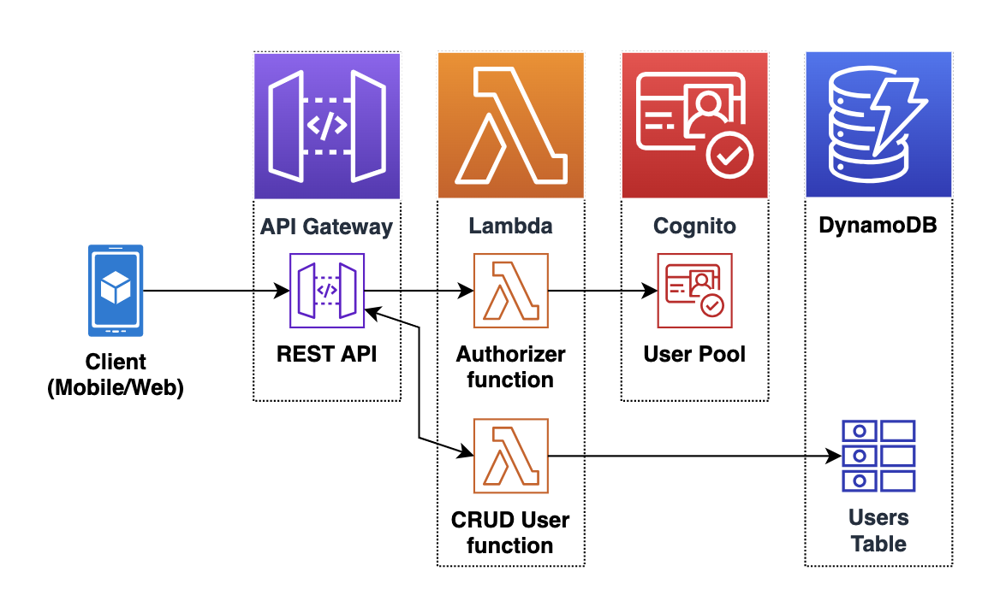
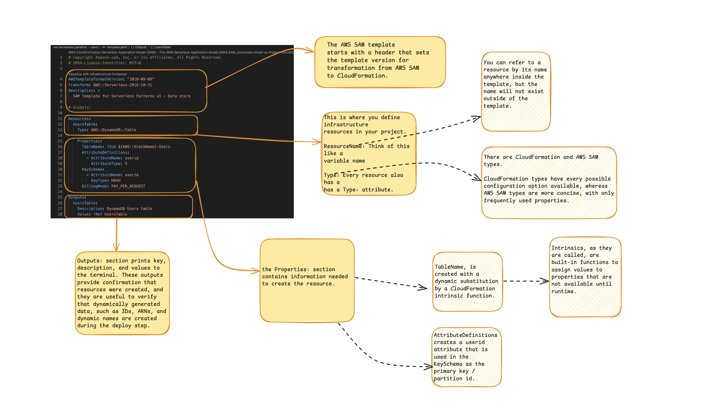
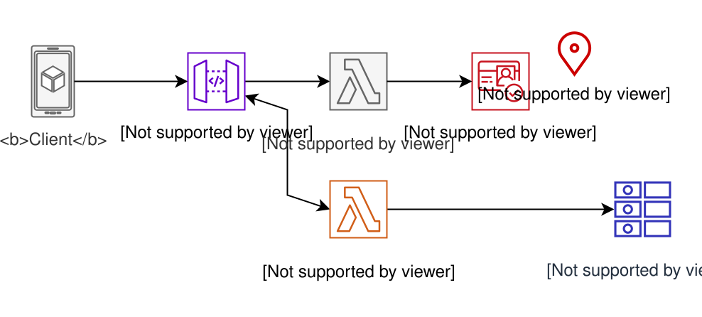

# Build Serverless Production Application

## Reference

- [Serverless Patterns - Building an Application](https://catalog.workshops.aws/serverless-patterns/en-US)



### Build and Deploy the Project

1. Use the cookiecutter file to initialize the project structure.

    ```sh
    sam init --name "ws-serverless-patterns" --location "https://ws-assets-prod-iad-r-iad-ed304a55c2ca1aee.s3.us-east-1.amazonaws.com/76bc5278-3f38-46e8-b306-f0bfda551f5a/module2/sam-python/sam-cookiecutter-2023-11-03.zip"

    cd ws-serverless-patterns

    rm samconfig.toml

    cd ./users
    ```

1. Sam Template Description
    

1. Build the Project

    ```sh
    cd ~/environment/ws-serverless-patterns/users
    sam build
    ```

    - The sam build command processes your `AWS SAM template file`, `application code`, and any applicable `language-specific files` and `dependencies`. 
    - The command also copies build artifacts in the format and location expected for subsequent steps in your workflow. 
    - You specify dependencies in a manifest file that you include in your application, such as requirements.txt for Python functions, or package.json for Node.js functions.

1. Deploy the Project

    ```sh
    sam deploy --guided --stack-name ws-serverless-patterns-users
    ```

1. Add Business Logic

    ```sh
    UsersFunction:
        Type: AWS::Serverless::Function
        Properties:
        Handler: src/api/users.lambda_handler
        Description: Handler for all users related operations
        Environment:
            Variables:
            USERS_TABLE: !Ref UsersTable
        Policies:
            - DynamoDBCrudPolicy:
                TableName: !Ref UsersTable
        Tags:
            Stack: !Sub "${AWS::StackName}"
    ```

By convention, the name of the Lambda event handler function is lambda_handler. The handler property is the path to the Users.py file, but the suffix ".py" has been replaced with the function handler name ("lambda_handler"). This will become clearer when you later create the Lambda function.


### 2 - Test SAM Locally

This shows how you can run the Lambda function from IDE with sam local invoke. Running the function locally provides fast unit testing, but it is best practice to also perform integration tests.

1. Login to ECR public registry

    ```sh
      aws ecr-public get-login-password --region us-east-1 | docker login --username AWS --password-stdin public.ecr.aws
    ```

1. Events are created to test each resource and path in the application. check `~/environment/ws-serverless-patterns/users/events/event-post-user.json`

1. Test Function locally

    To do this, run the Lambda function from IDE with `sam local invoke`.

    ```sh
    DOCKER_HOST=unix:///Users/a/.docker/run/docker.sock sam local invoke -e events/event-post-user.json -n env.json
    ```

    When you run this, AWS SAM builds an image. 

### 3 - Connect an API

- To track requests through the application, X-Ray tracing is enabled with the TracingEnabled attribute. The tag attribute provides additional meta data for reporting and aggregating activity for this stack and the API.

- The RestAPI event is added to UsersFunction. Now, each request to the API endpoint will invoke UsersFunction. 

- `sam build && sam deploy`

- `export API_ENDPOINT=$(aws cloudformation describe-stacks --stack-name ws-serverless-patterns-users --output text --query "Stacks[0].Outputs[?OutputKey=='APIEndpoint'].OutputValue")
echo "API endpoint: $API_ENDPOINT"`

- Make request to the API using `curl $API_ENDPOINT/users`

### 3.1 - Create User Pool



For the API authentication and authorization, you will use a Lambda Authorizer function in API Gateway. An Amazon Cognito User Pool will be used for the user directory. The pool will require two attributes for each user: name & email.

Amazon Cognito provides user sign-up, sign-in, and access control. It supports sign-in with social identity providers and enterprise identity providers via SAML 2.0 and OpenID Connect.

- A `client` and `domain` for the user pool, and a group to specify admin-level users will be created.

### 3.2 - Secure the API

- Set up an authorizer function which can be quickly modified to enable any OpenID Connect (OIDC) compliant IdP to provide authentication and authorization for your API.

- To do this, you will create a custom Lambda authorizer function (authorizer.py) that uses JWT-based authorization and dynamically generates security policies for the API. This approach can be used for 3rd party IdPs - Okta, Ping, Auth0, and others, with minimal changes.

- When invoked, the authorizer function will validate the token in the API request and extract the principal ID. The function will then use the principal ID (a GUID in this case) to restrict access to the resources specific to that user. The authorizer also checks the principal ID is a member of the Amazon Cognito user pool group apiAdmins.

```sh
  AuthorizerFunction:
    Type: AWS::Serverless::Function
    Properties:
      Handler: src/api/authorizer.lambda_handler
      Description: Handler for Lambda authorizer
      Environment:
        Variables:
          USER_POOL_ID: !Ref UserPool
          APPLICATION_CLIENT_ID: !Ref UserPoolClient
          ADMIN_GROUP_NAME: !Ref UserPoolAdminGroupName
      Tags:
        Stack: !Sub "${AWS::StackName}"
```

- The function type is an AWS SAM resource `AWS::Serverless::Function` which automatically creates not only the Lambda function, but also an IAM execution role and event source mappings to trigger the function.

- Note - the Handler property has a convention of: `<path-to-function>/<function-file-name-without-suffix>.<handler_method_name>`

```sh
RestAPI:
     ...
      Auth:
        DefaultAuthorizer: LambdaTokenAuthorizer
        Authorizers:
          LambdaTokenAuthorizer:
            FunctionArn: !GetAtt AuthorizerFunction.Arn
            Identity:
              Headers:
                - Authorization
```

- This connects the LambdaTokenAuthorizer to secure the API. The Authorizer function is specified by the ARN. Another intrinsic CloudFormation function.

### 3.3 - Verify Authorization

- Login with the Cognito Login URL from output
- Create a new user
- Copy the cognito auth command and replace with correct username and password.
- Get and store ID token `export ID_TOKEN=$(<Cognito authentication command>); echo $ID_TOKEN`
- Try the API request again to get the list of users, using the identity token as the Authorization header value:

```sh
curl $API_ENDPOINT/users -H "Authorization:$ID_TOKEN"
```

- To get your own info, you need to know your principal ID. The principal ID is created by Amazon Cognito and is not your userid.
- To find get your principal ID, you need to decode and extract it from the JWT ID token:
- The sub field in the payload data is the principal ID

```sh
curl $API_ENDPOINT/users/<sub-value> -H "Authorization:$ID_TOKEN"
```

### 5 - Integration Test

`export ENV_STACK_NAME=ws-serverless-patterns-users`
`python3.11 -m pytest tests/integration -v`


### 6 - Observability Of the App

- A successful observability strategy captures metrics that help you make decisions.

- API Gateway access logging
- Amazon SNS topic for alarm messaging
- Alarms
  - API Gateway
  - Lambda Authorizer function
  - Business logic Lambda function

- Configure access and execution logging in API Gateway and configure an Amazon SNS topic for messaging.

**API Gateway access logging**

The existing API Gateway logging permissions are set so the service can send logs to CloudWatch. The template creates an IAM role to be used for API logging, and then connects API Gateway to that newly created role to write API logs to CloudWatch Logs.

```sh
  ApiLoggingRole:
    Type: AWS::IAM::Role
    Properties:
      AssumeRolePolicyDocument:
        Version: "2012-10-17"
        Statement:
          - Effect: Allow
            Principal:
              Service:
                - apigateway.amazonaws.com
            Action: "sts:AssumeRole"
      Path: /
      ManagedPolicyArns:
        - arn:aws:iam::aws:policy/service-role/AmazonAPIGatewayPushToCloudWatchLogs

  ApiGatewayAccountLoggingSettings:
    Type: AWS::ApiGateway::Account
    Properties:
      CloudWatchRoleArn: !GetAtt ApiLoggingRole.Arn
```

API Gateway access logs entries are set to stream in to CloudWatch logs and The following properties for the RestAPI resource enable API Gateway access and execution logging :

```sh
 AccessLogs:
    Type: AWS::Logs::LogGroup
    DependsOn: ApiLoggingRole
    Properties:
      RetentionInDays: 30
      LogGroupName: !Sub "/${AWS::StackName}/APIAccessLogs"

AccessLogSetting:
  DestinationArn: !GetAtt AccessLogs.Arn
  Format: '{ "requestId":"$context.requestId", "ip": "$context.identity.sourceIp", "requestTime":"$context.requestTime", "httpMethod":"$context.httpMethod","routeKey":"$context.routeKey", "status":"$context.status","protocol":"$context.protocol", "integrationStatus": $context.integrationStatus, "integrationLatency": $context.integrationLatency, "responseLength":"$context.responseLength" }'
MethodSettings:
  - ResourcePath: "/*"
    LoggingLevel: INFO
    HttpMethod: "*"
    DataTraceEnabled: True       
```

### 6.1 - Set Alarms

A metric alarm watches a single CloudWatch metric, or the result of a math expression based on CloudWatch metrics. The alarm performs one or more actions based on the value of the metric, or the result of an expression, relative to a threshold over a number of time periods.

To help identify surges in traffic, an alarm based on throttled invocations is added to the Lambda Authorizer. Throttling means a request is not handled by your function. Throttling can happen when a function receives a sudden burst in traffic and reaches the concurrency limits for your account:

```sh
AuthorizerFunctionThrottlingAlarm:
    Type: AWS::CloudWatch::Alarm
    Properties:
      AlarmActions:
        - !Ref AlarmsTopic
      Dimensions:
        - Name: FunctionName
          Value: !Ref AuthorizerFunction
      Namespace: AWS/Lambda
      MetricName: Throttles
      Statistic: Sum
      ComparisonOperator: GreaterThanOrEqualToThreshold
      Threshold: 1.0
      Period: 60
      EvaluationPeriods: 1
```

Simulate Lambda throttling by setting the reserved concurrency for the function to zero (0):

```sh
aws lambda put-function-concurrency \
    --function-name  <UsersFunction name from the stack outputs>  \
    --reserved-concurrent-executions 0
```

### 6.2 - Display a Dashboard

CloudWatch dashboards are customizable home pages in the CloudWatch console that you can use to monitor your resources in a single view, even those resources that are spread across different Regions. You can use CloudWatch dashboards to create customized views of the metrics and alarms for your AWS resources.

Create an CloudWatch Dashboard that shows readouts from components of your application.

A good method to create dashboard definitions is building the dashboard with the AWS Management Console then exporting the JSON definition. You will still need to replace resource names in the definition with references to the resources in your template, but it's a quick way to get started!

### Delete SAM Template

```sh
sam delete --stack-name ws-serverless-patterns-users
```